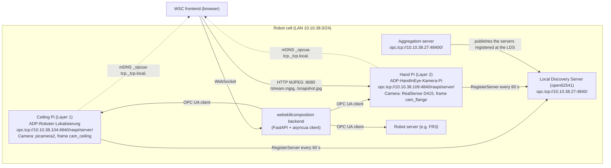

# Code Documentation: Overview

Status: 2026-11-17. Covers the ADP repository (branch `main`) and the
webskillcomposition repository (branch `ADP_Lokalisierung`, our share of the code).

This page is the entry point. It shows which parts exist, how they connect, and where
each part is described in detail. The detail pages are in [`code/`](code/).

**Conventions**

- Docstrings and code comments are in English. Python uses PEP 257 with Google style
  (`Args:`, `Returns:`, `Raises:`).
- Log, error and OPC UA messages stay in German. They are meant for operators and some
  tests check them.

---

## 1. Parts and detail pages

| Area | Repository and branch | Detail page |
| --- | --- | --- |
| Localization library, CLI, jobs, use-case evaluation, UA program (`src/tagloc/`, `src/jobs/`, `src/use_case_eval/`, `src/ua_program/`) | ADP, `main` | [`code/zelle-tagloc.md`](code/zelle-tagloc.md) |
| Vision server on the Raspberry Pis, OPC UA (`src/vision_server/`) | ADP, `main` | [`code/zelle-vision-server.md`](code/zelle-vision-server.md) |
| Tools, deployment, config, data layout, tests (`tools/`, `deploy/`, `config/`, `data/`, `tests/`) | ADP, `main` | [`code/zelle-tools-tests.md`](code/zelle-tools-tests.md) |
| Cell modules: model and UI (`frontend/src/features/cell-modules/`) | webskillcomposition, `ADP_Lokalisierung` | [`code/webskill-cell-modules.md`](code/webskill-cell-modules.md) |
| Other frontend code (OPC UA connection, viewport, robot control, tag tool, shared code) | webskillcomposition, `ADP_Lokalisierung` | [`code/webskill-frontend.md`](code/webskill-frontend.md) |
| Backend: API, WebSocket, OPC UA client, runtime | webskillcomposition, `ADP_Lokalisierung` | [`code/webskill-backend.md`](code/webskill-backend.md) |

---

## 2. System picture

- **The Pis are OPC UA servers.** They do not open OPC UA connections to other servers.
  The only exception is the registration at the discovery server (`RegisterServer`).
- **The backend is the client.** It connects to the fixed Pi URLs. In webskillcomposition
  these are in `frontend/src/features/opcua-server/config/piServers.ts`.
- **Only the backend moves the robot.** The Pis know the robot only through the poses the
  backend passes to them (Layer 2, hand-eye captures).
- **The browser reads the live image** directly from the hand Pi over MJPEG. All other
  traffic goes through the backend WebSocket.

## 3. Connection paths

| Path | Mechanism |
| --- | --- |
| Frontend to Pi method | Hook → `ApplicationController.callRawMethod()` → `WscWebSocketClient.callRawMethod()` → backend `CallRawMethodCommand` (`runtime/application_service.py`) → `AsyncUaServerConnection` → Pi |
| Pi subscriptions and results | Pi → backend OPC UA subscription → backend WebSocket → frontend |
| Live image | Pi HTTP server (`vision_server/mjpeg_server.py`), port from `CameraStreamHttpPort` (default 8080) |
| Pi discovery | Registration at the LDS every 60 s (`vision_server/discovery/lds.py`); mDNS for clients in the subnet (`vision_server/discovery/mdns.py`) |

The Pi endpoint is `opc.tcp://0.0.0.0:4840/raspi/server/` with `NoSecurity`. The namespace
`http://launch-rm.de/vision` must be resolved with `get_namespace_index(uri)`, never
hard-coded. Details: [`code/zelle-vision-server.md`](code/zelle-vision-server.md).

Where the robot and the Pis exchange work, the data formats are fixed in the interface
documents:

- Pi OPC UA interface (methods, nodes, payloads): [`vision-server-interface.md`](vision-server-interface.md)
- Frontend and backend data model (webskillcomposition): `docs/data-and-interface-model.md`
  in the webskillcomposition repository

## 4. Project documents

| Document | Use |
| --- | --- |
| [`vision-server-interface.md`](vision-server-interface.md) | OPC UA interface of the Pi server |
| [`vision-system.md`](vision-system.md) | State of the vision system on the Pis |
| [`vision-system-integration.md`](vision-system-integration.md) | Integration into webskillcomposition |
| [`apriltag-lokalisierung.md`](apriltag-lokalisierung.md) | AprilTag localization concept |
| [`apriltag-referenz.md`](apriltag-referenz.md) | AprilTag reference: functions, CLI, file formats |
| [`layer2-regeln.md`](layer2-regeln.md) | Layer 2 rules |
| [`arbeitsplaene/README.md`](arbeitsplaene/README.md) | Index of work plans and their status |

## 5. Run flow in brief

1. **Layer 1 (ceiling Pi):** the backend calls `StartSingleJob` with `apriltag`. The Pi
   computes the camera pose from the world tags (`localize_camera`), then the module
   poses (`locate_modules`), and returns both as event and in `LatestResultJson`.
2. **Layer 2 (hand Pi):** the backend moves the robot. The hand Pi measures each tag
   (`MeasureTags`), or plans the run itself (`StartLayer2Run` → `Layer2Target` →
   `ReportRobotPose`). The camera pose is the flange pose times the hand-eye transform.
3. **Calibration:**
   - Ceiling Pi: `StartCalibration` … `FinishCalibration` (intrinsics only). The board
     is chosen with `StartCalibration`'s `OptionsJson` (since 17.11.2026); empty means the
     configured board.
   - Hand Pi: `StartHandEyeCalibration` with `fullCalibration: true`. The robot moves
     through the poses; at the end the Pi writes intrinsics and hand-eye, keeps the old
     files as `.bak`, and applies both live.
