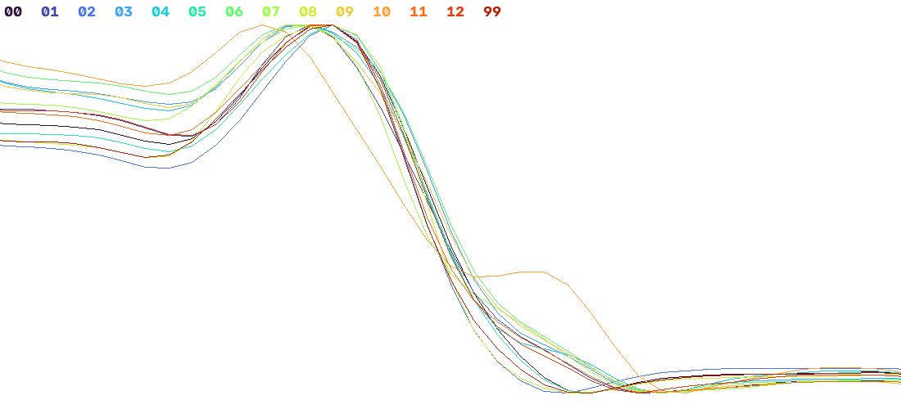

# Ceiling camera: image quality, camera settings and detector parameters

**As of:** 19.10.2026 · **Camera:** Pi 1, `cam_ceiling`, Raspberry Pi HQ Camera (IMX477), M12 fisheye with fixed aperture, 4056×3040 · **Family:** tag36h11, module tags 8 cm

Measurement report as the basis for the thesis. Bullet points with evidence; the
raw images are in the repo, the figures under `bilder/kamera-analyse/`.
Related work plans: `arbeitsplaene/apriltag-erkennung-unscharfe-tags.md`,
`arbeitsplaene/kamera-controls-und-detektor-parameter.md`.

## 1. Data basis

| Image | Content | Location |
| --- | --- | --- |
| A, "unscharf" (blurred) | first raw image, focus misadjusted | `data/rohbilder/cam_ceiling_20261019-114704.png` (branch `apriltag`) |
| B, "Fokus neu" (focus new) | after readjusting the focus, scene rearranged | `data/rohbilder/cam_ceiling_20261019-142133.png` (branch `apriltag`) |
| C, settings test | 14 captures in a row, one camera setting each, constant light | `data/rohbilder/camera_settings_test/20261019-151652/` (only branch `kamera-einstellungen-test`) |

- Captured with the button "📷 Rohbild speichern" (save raw image) (OPC UA method `SaveRawImage`, lossless PNG) or the one-off script `tools/kamera_einstellungen_test.py` (branch `kamera-einstellungen-test`).
- Ground truth (confirmed by the team): A contains 0, 1, 2, 3, 583; B contains 0, 1 (twice), 2, 3, 583, 586 as well as 585 (damaged, optional).
- Detector: OpenCV ArUco (`cv2.aruco`, OpenCV 5.0.0 on the PC), grey image without preprocessing, as in the server (`tagloc.detector.ArucoTagDetector`).

## 2. Initial problem: blurred image (A)

*Fig. 1: Crops of the five tags in image A. With OpenCV default parameters only 1, 2 and 583 are detected.*

- Standard detector: **[1, 2, 583]**. 0 and 3 are missing.
- The quadrilaterals of 0 and 3 **are found** (they lie in `rejectedImgPoints`). Only the bit reading fails.
  - Tag 0: about 60 px edge length, **4 bit errors**. With the standard `errorCorrectionRate` 0.6, at most 3 are correctable.
  - Tag 3: about 50 px edge length, contrast only **60 grey levels** (white 221, border 161), decoded incorrectly.
- Cause: the image is optically soft.
  - Edge width (10–90 %) **4–8 px** with a cell size of only 6–13 px.
  - No preferred direction, so not motion blur but defocus.
  - Noise is low (standard deviation < 1.3 grey levels) and plays no role.
- Additionally, white is partly blown out: tag 1 at 17 %, tag 0 at 6 %, across the whole image 3 % ≥ 250.

### 2.1 Software countermeasures (detector parameters)

Tested on image A, PC runtime on 12 MP. Pi 4 roughly 5–10× slower.

| Variant | detected IDs | Time |
| --- | --- | --- |
| OpenCV default | 1, 2, 583 | 0.13 s |
| `minMarkerPerimeterRate`, `polygonalApproxAccuracyRate`, `useAruco3Detection`, `adaptiveThreshWinSize*`, individual colour channels, sharpening, upscaling/downscaling | 1, 2, 583 (sometimes fewer) | 0.06–0.35 s |
| CLAHE (clip 2, 8×8) | 0, 1, 2, 3, 583 | 0.14 s |
| **`errorCorrectionRate` 1.0, `perspectiveRemoveIgnoredMarginPerCell` 0.3, `perspectiveRemovePixelPerCell` 8** | **0, 1, 2, 3, 583** | **0.09 s** |
| `CORNER_REFINE_APRILTAG` (subpixel) | only 583 | 2.7 s |

- The three decoding parameters act precisely on the step that failed.
  - Finer grid: 8 instead of 4 pixels per cell.
  - Only the cell centre counts: border 0.3 instead of 0.13, the blurred cell edges drop out.
  - 5 instead of 3 correctable bits.
  - The parameter field is robust: border 0.2–0.4 and ppc 8–10 find all five tags.
- Cost: the theoretical false-alarm risk per quadrilateral candidate rises from about 0.03 % to about 1.5 %. On 41 images there were 0 false alarms. However, those contained no tags.
- **CLAHE rejected:** it finds all tags, but produces false alarms on other images (pseudo-tags from amplified noise, e.g. ID 564, ID 80).
- **Subpixel refinement (`CORNER_REFINE_APRILTAG`) rejected:**
  - It replaces the quadrilateral search with its own quad detector on the full image. That is 20× slower.
  - On this image it loses tags: the quadrilaterals shifted by about 1 px can no longer be decoded with the standard grid.
- Conclusion for A: software can partly absorb defocus, but only at the expense of false-alarm safety.

## 3. Hardware measure: focus readjusted (B)

*Fig. 2: The same tags before and after readjusting the focus. Scene and tag positions changed in between.*

- The M12 optics have **no aperture**. Only the focus (turning the lens in the thread) and the ISP or exposure controls are adjustable.
- After focusing, the **OpenCV default** finds all tags: **[0, 1, 1, 2, 3, 583, 586]**.
  - Both physical tags with ID 1 are detected.
  - 585 (damaged) is found only with relaxed parameters. It should be reprinted rather than optimised for.
- Consequence: the software parameters from section 2.1 were **withdrawn**; the preset is back to the OpenCV default (`detector_parameters: {}`).
- Detector parameters and camera controls have since been adjustable without code changes, via the preset or via the environment variables `VISION_APRILTAG_DETECTOR_PARAMS` and `VISION_CAMERA_CONTROLS` (see `vision-system.md`, section "Kamera-Controls (Picamera2)" (camera controls (Picamera2))).

## 4. Camera settings compared (C)

### 4.1 Test

- 14 captures. For each capture the camera is reopened, so that no setting carries over into the next.
- The settings each change only one adjustment relative to automatic mode:
  - 00 automatic
  - 01/02 `ExposureValue` −0.5/−1.0
  - 03/04 `Sharpness` 1.5/2.5
  - 05 `Contrast` 1.25
  - 06/07 `NoiseReductionMode` Off/HighQuality
  - 08 `AeMeteringMode` Matrix
  - 09–11 fixed exposure: as automatic / half the time at double gain / −0.7 EV
  - 12 combination
  - 99 automatic as a control
- Control: 00, 09 and 99 are practically identical (exposure 20.8 ms, gain 2.0, about 355 lx). The light was therefore constant.
- Result on the Pi: **all 14 settings** detect [0, 1, 2, 3, 583, 586].
  - The second ID 1 was covered by the robot arm (Fig. 6); this is not a detection error.
  - **Bit errors 0** for all tags in all images. All tags are found even with `errorCorrectionRate` 0.0.
- Because all settings find all tags, the **reserve** was measured. For this, the images are artificially degraded:
  - Blur 2–5
  - Downscaling ×0.3–×0.2, simulating more distant or smaller tags
  - Noise σ 24/40
  - Brightness ×0.5/×0.3
  - The sum of the bit errors is counted. Smaller means more reserve.

### 4.2 Result

*Fig. 3: The same tag (ID 3, smallest tag in the image) under seven settings. With 05 (contrast) and 08 (matrix metering) the white burns out.*

*Fig. 4: Sum of the bit errors under artificial degradation, per setting. The grey band is the scatter of the three identical automatic images (±2–3). Differences from about 8–10 points onward are reliable.*

| Rank | Setting | Stress errors | Margin* | Burnt out (tag 0/1/3) | Assessment |
| --- | --- | --- | --- | --- | --- |
| 1 | 12 combi (EV −0.5, sharpness 1.5, contrast 1.15, NR Fast) | 125 | 44 | 1 / 0.1 / 13.5 % | best black-and-white separation without clipping |
| 2 | 02 EV −1.0 | 123 | 37 | 0 % | tied, but very dark; risky with less light |
| 3 | 04 sharpness 2.5 | 127 | 42 | 30 / 12 / 51 % | more noise, slight halo |
| 4 | 11 fixed −0.7 EV | 128 | 38 | 0 % | |
| 5 | 01 EV −0.5 | 131 | 37 | 0 % | |
| 6 | 03 sharpness 1.5 | 134 | 41 | 22 / 7 / 45 % | |
| 7 | 10 half time, double gain | 137 | 41 | 24 / 10 / 45 % | |
| 8–12 | 00/09/99 automatic, 06 NR Off, 07 NR HQ | 139–142 | 34–40 | 15–21 / 5–7 / 38–48 % | reference |
| 13 | 05 contrast 1.25 | 145 | 43.5 | 100 % | clipping |
| 14 | 08 matrix metering | 152 | 28 | 100 % | overexposed, worst margin |

\* Margin = smallest distance of a cell to the Otsu threshold, in grey levels, minimum over all tags.

- **Lowering the exposure slightly helps the most.**
  - In automatic mode the white of the tags is 15–48 % burnt out.
  - Overexposed white bleeds into the black neighbouring cells.
  - The small tags (50–64 px) benefit the most.
- **Sharpness also helps at the same exposure** (2.5: 127 instead of 142).
  - Noise rises by about 45–75 % in the process. In absolute terms this is at most 1.7 grey levels at about 125 grey levels of black-white contrast, so irrelevant for decoding.
  - Halo: no white overshoot, the black undershoot grows from 4 % to 9 % (Fig. 7).
  - The edge width does not change measurably (1.5–1.7 px). After focusing, the optics are no longer the bottleneck.
- **Contrast 1.25 and matrix metering are harmful:** both burn out the white of the tags completely.
- **Noise reduction does not matter** (Off, Fast and HighQuality are tied). Off only increases the noise.
- **Corner accuracy:**
  - Darker settings yield quadrilaterals that are 0.1–0.4 px larger, for tag 586 up to 0.7 px. This is above the repeatability, but below 1 px.
  - Sharpness does not shift the corners systematically.
  - The calibration should be captured with the same setting that is used in operation.
- **False alarms:**
  - With standard parameters there is no wrong ID in any image.
  - The number of rejected candidates rises slightly with sharpness and contrast (48 → 61/62).
  - With strongly relaxed parameters, wrong IDs occur (315, 379).

*Fig. 5: Image 12 (combi) with the detected tags, OpenCV default.*

*Fig. 6: Position of the second ID 1. Left image B (detected), right settings test: covered by the robot arm.*

*Fig. 7: Edge profiles across a black-white edge per setting, with undershoot at higher sharpness.*

## 5. Detector parameters on the sharp image

Measured on image 12 and four further images from C, under strong artificial degradation (blur 3.5–5, downscaling ×0.25–×0.15, noise σ 24). Maximum 54 hits.

| Parameter | Hits (image 12) | Remark |
| --- | --- | --- |
| OpenCV default | 42 | no false alarms |
| `perspectiveRemovePixelPerCell` 8 | 45 | +3 to +5 on all five images, without false alarms and without more candidates |
| `adaptiveThreshWinSizeStep` 4 | 45 | no additional gain, more candidates (66 instead of 56) |
| `errorCorrectionRate` 1.0 | 48 | **wrong ID** in 2 of 5 images at noise σ 24 |
| `errorCorrectionRate` 0.2 | 34 | less reserve |
| `CORNER_REFINE_APRILTAG` | 23 instead of 42 | loses range, individual corner jumps by 968 px |

- On the real, undisturbed images the default finds everything. A change only provides reserve.
- Higher error correction buys range with false alarms. For cell monitoring that reacts to missing or new tags, this is the wrong trade-off.
- Subpixel refinement stays off. SUBPIX only brings corner noise down by 0.1–0.3 px, APRILTAG costs range.

## 6. Recommendation

| What | Value | Justification |
| --- | --- | --- |
| Focus | at floor level of the cell, locking nut fixed | largest single effect (section 3) |
| Camera controls `cam_ceiling` | `{"ExposureValue": -0.5, "Sharpness": 1.5, "Contrast": 1.15, "NoiseReductionMode": "Fast"}` | rank 1, no clipping, no excessively dark image |
| Detector parameters `cam_ceiling` | `{"perspectiveRemovePixelPerCell": 8}` (or `{}`) | small reserve without false-alarm risk |
| Do not use | `Contrast` ≥ 1.25, `AeMeteringMode: Matrix`, `errorCorrectionRate` > 0.6, CLAHE, `CORNER_REFINE_APRILTAG` | clipping, false alarms or loss of range respectively |
| Tag 585 | reprint | damaged, readable only with risky parameters |

## 7. Limitations and open points

- The reserve was measured with **artificial** degradation. Real difficult cases are missing: tags at the image edge, oblique viewing angle, different lighting.
- The values apply to the hall lighting of 19.10.2026 (about 355 lx). With significantly less light, EV −1.0 is too dark. EV −0.5 with automatic mode adapts.
- Not yet captured, but promising: `{"ExposureValue": -0.5, "Sharpness": 2.5, "Contrast": 1.15}`.
- The Pi runs OpenCV 4.x, the measurements on the PC used 5.0. The parameter names are the same; a cross-check on the Pi is still pending.
- The calibration (`data/calibration/cam_ceiling.json`) was made before focusing. A recalibration with the final camera settings is necessary, because focus slightly changes the focal length.
- Evaluation scripts (not in the repo): ground truth, bit errors, stress tests, parameter sweeps. The key figures of this report come from them.

## 8. Addendum 10.11.2026: subpixel corners (`subpix`) against pose jitter

Section 5 evaluated subpixel with a view to the **number of hits**. For
the **stillness of the pose**, the brightness test of 09.11. shows a different picture. Without
refinement, ArUco on the ceiling delivers integer corners. An 80 mm tag is
only about 85 px in size at 1.6 m.

| Light | Corner sd ArUco, integer | Corner sd pupil_apriltags, subpixel-accurate | z sd | Rotation RMS |
| --- | --- | --- | --- | --- |
| 100 % | 0.68 px | 0.08 px | 5.9 mm | 8.7° |
| 80 % | 1.00 px | 0.11 px | 6.4 mm | 8.9° |
| 50 % | 1.07 px | 0.24 px | 8.0 mm | 9.1° |

The 0.1–0.3 px from section 5 is therefore 5 to 8 times less noise than the
current state. `CORNER_REFINE_SUBPIX` on 19 real 12 MP images (all
light levels, PC, OpenCV 5.0) finds the same IDs as without refinement. The
runtime rises by 3 % (median 86.7 → 89.0 ms). The warning about range and
CPU only concerns `CORNER_REFINE_APRILTAG`.

- **Decision:** preset `cam_ceiling` with `subpix` on
  (work plan [`deckenkamera-subpixel-ecken.md`](arbeitsplaene/deckenkamera-subpixel-ecken.md)).
- **Open:** confirmation on the Pi with a series of brightness tests. A large part of the
  rotation scatter comes from the IPPE ambiguity
  (about 2/3 of the images `ambiguous`). Subpixel alone presumably does not eliminate it.
