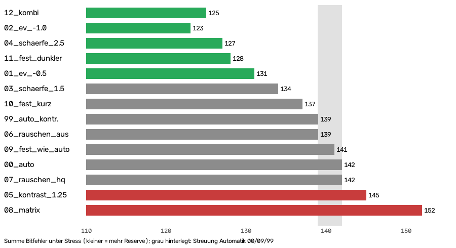
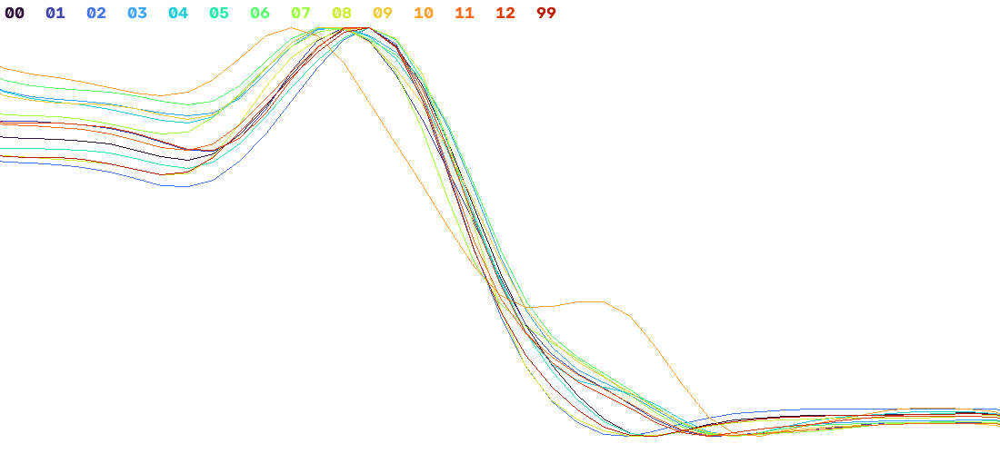

# Deckenkamera: Bildqualität, Kamera-Einstellungen und Detektor-Parameter

**Stand:** 19.10.2026 · **Kamera:** Pi 1, `cam_ceiling`, Raspberry Pi HQ Camera (IMX477), M12-Fischauge mit fester Blende, 4056×3040 · **Familie:** tag36h11, Modultags 8 cm

Messbericht als Grundlage für die Ausarbeitung. Stichpunkte mit Belegen; die
Rohbilder liegen im Repo, die Abbildungen unter `bilder/kamera-analyse/`.
Zugehörige Arbeitspläne: `arbeitsplaene/apriltag-erkennung-unscharfe-tags.md`,
`arbeitsplaene/kamera-controls-und-detektor-parameter.md`.

## 1. Datengrundlage

| Bild | Inhalt | Ort |
| --- | --- | --- |
| A, „unscharf“ | erstes Rohbild, Fokus verstellt | `data/rohbilder/cam_ceiling_20261019-114704.png` (Branch `apriltag`) |
| B, „Fokus neu“ | nach Nachstellen des Fokus, Szene umgebaut | `data/rohbilder/cam_ceiling_20261019-142133.png` (Branch `apriltag`) |
| C, Einstellungstest | 14 Aufnahmen hintereinander, je eine Kamera-Einstellung, konstantes Licht | `data/rohbilder/camera_settings_test/20261019-151652/` (nur Branch `kamera-einstellungen-test`) |

- Aufgenommen mit dem Button „📷 Rohbild speichern“ (OPC-UA-Methode `SaveRawImage`, PNG verlustfrei) bzw. dem Einmal-Skript `tools/kamera_einstellungen_test.py` (Branch `kamera-einstellungen-test`).
- Ground Truth (vom Team bestätigt): A enthält 0, 1, 2, 3, 583; B enthält 0, 1 (zweimal), 2, 3, 583, 586 sowie 585 (beschädigt, optional).
- Detektor: OpenCV-ArUco (`cv2.aruco`, OpenCV 5.0.0 am PC), Graubild ohne Vorverarbeitung, wie im Server (`tagloc.detector.ArucoTagDetector`).

## 2. Ausgangsproblem: unscharfes Bild (A)

*Abb. 1: Ausschnitte der fünf Tags in Bild A. Mit OpenCV-Standardparametern werden nur 1, 2 und 583 erkannt.*

- Standard-Detektor: **[1, 2, 583]**. Es fehlen 0 und 3.
- Die Vierecke von 0 und 3 **werden gefunden** (sie liegen in `rejectedImgPoints`). Es scheitert erst das Auslesen der Bits.
  - Tag 0: etwa 60 px Kantenlänge, **4 Bitfehler**. Mit Standard-`errorCorrectionRate` 0.6 sind höchstens 3 korrigierbar.
  - Tag 3: etwa 50 px Kantenlänge, Kontrast nur **60 Graustufen** (Weiß 221, Rand 161), wird falsch dekodiert.
- Ursache: Das Bild ist optisch weich.
  - Kantenbreite (10–90 %) **4–8 px** bei einer Zellgröße von nur 6–13 px.
  - Keine Vorzugsrichtung, also keine Bewegungsunschärfe, sondern Defokus.
  - Rauschen ist niedrig (Standardabweichung < 1,3 Graustufen) und spielt keine Rolle.
- Zusätzlich ist Weiß teilweise ausgebrannt: Tag 1 zu 17 %, Tag 0 zu 6 %, im ganzen Bild 3 % ≥ 250.

### 2.1 Software-Gegenmaßnahmen (Detektor-Parameter)

Getestet auf Bild A, PC-Laufzeit auf 12 MP. Pi 4 grob 5–10× langsamer.

| Variante | erkannte IDs | Zeit |
| --- | --- | --- |
| OpenCV-Standard | 1, 2, 583 | 0,13 s |
| `minMarkerPerimeterRate`, `polygonalApproxAccuracyRate`, `useAruco3Detection`, `adaptiveThreshWinSize*`, einzelne Farbkanäle, Schärfen, Hoch-/Herunterskalieren | 1, 2, 583 (teils weniger) | 0,06–0,35 s |
| CLAHE (Clip 2, 8×8) | 0, 1, 2, 3, 583 | 0,14 s |
| **`errorCorrectionRate` 1.0, `perspectiveRemoveIgnoredMarginPerCell` 0.3, `perspectiveRemovePixelPerCell` 8** | **0, 1, 2, 3, 583** | **0,09 s** |
| `CORNER_REFINE_APRILTAG` (Subpixel) | nur 583 | 2,7 s |

- Die drei Dekodier-Parameter wirken genau auf den gescheiterten Schritt.
  - Feineres Raster: 8 statt 4 Pixel je Zelle.
  - Nur die Zellmitte zählt: Rand 0.3 statt 0.13, die verwaschenen Zellränder fallen weg.
  - 5 statt 3 korrigierbare Bits.
  - Das Parameterfeld ist robust: Rand 0.2–0.4 und ppc 8–10 finden alle fünf Tags.
- Preis: Das theoretische Fehlalarm-Risiko je Viereck-Kandidat steigt von etwa 0,03 % auf etwa 1,5 %. Auf 41 Bildern gab es 0 Fehlalarme. Die waren allerdings ohne Tags.
- **CLAHE verworfen:** Es findet alle Tags, erzeugt aber auf anderen Bildern Fehlalarme (Pseudo-Tags aus verstärktem Rauschen, z. B. ID 564, ID 80).
- **Subpixel-Verfeinerung (`CORNER_REFINE_APRILTAG`) verworfen:**
  - Sie ersetzt die Viereck-Suche durch einen eigenen Quad-Detektor auf dem vollen Bild. Das ist 20× langsamer.
  - Bei diesem Bild verliert sie Tags: Die um etwa 1 px verschobenen Vierecke sind mit Standard-Raster nicht mehr dekodierbar.
- Fazit für A: Software kann einen Defokus teilweise auffangen, aber nur auf Kosten der Fehlalarm-Sicherheit.

## 3. Hardware-Maßnahme: Fokus nachgestellt (B)

*Abb. 2: Dieselben Tags vor und nach dem Nachstellen des Fokus. Szene und Lage der Tags haben sich dazwischen geändert.*

- Die M12-Optik hat **keine Blende**. Einstellbar sind nur der Fokus (Objektiv im Gewinde drehen) und die ISP- bzw. Belichtungs-Controls.
- Nach dem Fokussieren findet der **OpenCV-Standard** alle Tags: **[0, 1, 1, 2, 3, 583, 586]**.
  - Beide physischen Tags mit ID 1 werden erkannt.
  - 585 (beschädigt) wird nur mit gelockerten Parametern gefunden. Er sollte neu gedruckt werden, statt dafür zu optimieren.
- Konsequenz: Die Software-Parameter aus Abschnitt 2.1 wurden **zurückgenommen**, das Preset steht wieder auf OpenCV-Standard (`detector_parameters: {}`).
- Detektor-Parameter und Kamera-Controls sind seitdem ohne Codeänderung einstellbar, über das Preset oder über die Umgebungsvariablen `VISION_APRILTAG_DETECTOR_PARAMS` und `VISION_CAMERA_CONTROLS` (siehe `vision-system.md`, Abschnitt „Kamera-Controls (Picamera2)“).

## 4. Kamera-Einstellungen im Vergleich (C)

### 4.1 Versuch

- 14 Aufnahmen. Je Aufnahme wird die Kamera neu geöffnet, damit keine Einstellung in die nächste nachwirkt.
- Die Einstellungen ändern jeweils nur eine Stellschraube gegenüber der Automatik:
  - 00 Automatik
  - 01/02 `ExposureValue` −0.5/−1.0
  - 03/04 `Sharpness` 1.5/2.5
  - 05 `Contrast` 1.25
  - 06/07 `NoiseReductionMode` Off/HighQuality
  - 08 `AeMeteringMode` Matrix
  - 09–11 feste Belichtung: wie Automatik / halbe Zeit bei doppeltem Gain / −0,7 EV
  - 12 Kombination
  - 99 Automatik zur Kontrolle
- Kontrolle: 00, 09 und 99 sind praktisch identisch (Belichtung 20,8 ms, Gain 2,0, etwa 355 lx). Das Licht war also konstant.
- Ergebnis am Pi: **alle 14 Einstellungen** erkennen [0, 1, 2, 3, 583, 586].
  - Die zweite ID 1 war vom Roboterarm verdeckt (Abb. 6), das ist kein Erkennungsfehler.
  - **Bitfehler 0** bei allen Tags in allen Bildern. Alle Tags werden sogar mit `errorCorrectionRate` 0.0 gefunden.
- Weil alle Einstellungen alle Tags finden, wurde die **Reserve** gemessen. Dazu werden die Bilder künstlich verschlechtert:
  - Unschärfe (Blur) 2–5
  - Verkleinern ×0,3–×0,2, simuliert entferntere oder kleinere Tags
  - Rauschen σ 24/40
  - Helligkeit ×0,5/×0,3
  - Gezählt wird die Summe der Bitfehler. Kleiner heißt mehr Reserve.

### 4.2 Ergebnis

*Abb. 3: Derselbe Tag (ID 3, kleinster Tag im Bild) unter sieben Einstellungen. Bei 05 (Kontrast) und 08 (Matrix-Messung) brennt das Weiß aus.*

*Abb. 4: Summe der Bitfehler unter künstlicher Verschlechterung, je Einstellung. Grau hinterlegt ist die Streuung der drei identischen Automatik-Bilder (±2–3). Unterschiede ab etwa 8–10 Punkten sind belastbar.*

| Rang | Einstellung | Stress-Fehler | Marge* | Ausgebrannt (Tag 0/1/3) | Bewertung |
| --- | --- | --- | --- | --- | --- |
| 1 | 12 Kombi (EV −0.5, Schärfe 1.5, Kontrast 1.15, NR Fast) | 125 | 44 | 1 / 0,1 / 13,5 % | beste Schwarz-Weiß-Trennung ohne Clipping |
| 2 | 02 EV −1.0 | 123 | 37 | 0 % | gleichauf, aber sehr dunkel; riskant bei weniger Licht |
| 3 | 04 Schärfe 2.5 | 127 | 42 | 30 / 12 / 51 % | mehr Rauschen, leichter Halo |
| 4 | 11 fest −0,7 EV | 128 | 38 | 0 % | |
| 5 | 01 EV −0.5 | 131 | 37 | 0 % | |
| 6 | 03 Schärfe 1.5 | 134 | 41 | 22 / 7 / 45 % | |
| 7 | 10 halbe Zeit, doppelter Gain | 137 | 41 | 24 / 10 / 45 % | |
| 8–12 | 00/09/99 Automatik, 06 NR Off, 07 NR HQ | 139–142 | 34–40 | 15–21 / 5–7 / 38–48 % | Referenz |
| 13 | 05 Kontrast 1.25 | 145 | 43,5 | 100 % | Clipping |
| 14 | 08 Matrix-Messung | 152 | 28 | 100 % | überbelichtet, schlechteste Marge |

\* Marge = kleinster Abstand einer Zelle zum Otsu-Schwellwert, in Graustufen, Minimum über alle Tags.

- **Belichtung leicht runter hilft am meisten.**
  - In der Automatik ist das Weiß der Tags zu 15–48 % ausgebrannt.
  - Überstrahltes Weiß läuft in die schwarzen Nachbarzellen.
  - Die kleinen Tags (50–64 px) profitieren am stärksten.
- **Schärfe hilft auch bei gleicher Belichtung** (2.5: 127 statt 142).
  - Das Rauschen steigt dabei um etwa 45–75 %. Absolut sind das höchstens 1,7 Graustufen bei etwa 125 Graustufen Schwarz-Weiß-Abstand, für die Dekodierung also irrelevant.
  - Halo: Kein weißer Überschwinger, der schwarze Unterschwinger wächst von 4 % auf 9 % (Abb. 7).
  - Die Kantenbreite ändert sich nicht messbar (1,5–1,7 px). Nach dem Fokussieren ist die Optik nicht mehr der Engpass.
- **Kontrast 1.25 und Matrix-Messung schaden:** Beide brennen das Weiß der Tags vollständig aus.
- **Rauschunterdrückung ist egal** (Off, Fast und HighQuality liegen gleichauf). Off erhöht nur das Rauschen.
- **Eckgenauigkeit:**
  - Dunklere Einstellungen liefern um 0,1–0,4 px größere Vierecke, bei Tag 586 bis 0,7 px. Das liegt über der Wiederholbarkeit, aber unter 1 px.
  - Schärfe verschiebt die Ecken nicht systematisch.
  - Die Kalibrierung sollte mit derselben Einstellung aufgenommen werden, die im Betrieb läuft.
- **Fehlalarme:**
  - Mit Standardparametern gibt es in keinem Bild eine falsche ID.
  - Die Zahl der verworfenen Kandidaten steigt mit Schärfe und Kontrast leicht (48 → 61/62).
  - Mit stark gelockerten Parametern treten falsche IDs auf (315, 379).

*Abb. 5: Bild 12 (Kombi) mit den erkannten Tags, OpenCV-Standard.*

*Abb. 6: Position der zweiten ID 1. Links Bild B (erkannt), rechts Einstellungstest: vom Roboterarm verdeckt.*

*Abb. 7: Kantenprofile über eine Schwarz-Weiß-Kante je Einstellung, mit Unterschwinger bei höherer Schärfe.*

## 5. Detektor-Parameter auf dem scharfen Bild

Gemessen auf Bild 12 und vier weiteren Bildern aus C, unter starker künstlicher Verschlechterung (Blur 3,5–5, Verkleinern ×0,25–×0,15, Rauschen σ 24). Maximal 54 Treffer.

| Parameter | Treffer (Bild 12) | Bemerkung |
| --- | --- | --- |
| OpenCV-Standard | 42 | keine Fehlalarme |
| `perspectiveRemovePixelPerCell` 8 | 45 | +3 bis +5 auf allen fünf Bildern, ohne Fehlalarme und ohne mehr Kandidaten |
| `adaptiveThreshWinSizeStep` 4 | 45 | kein Zusatzgewinn, mehr Kandidaten (66 statt 56) |
| `errorCorrectionRate` 1.0 | 48 | **falsche ID** in 2 von 5 Bildern bei Rauschen σ 24 |
| `errorCorrectionRate` 0.2 | 34 | weniger Reserve |
| `CORNER_REFINE_APRILTAG` | 23 statt 42 | verliert Reichweite, einzelne Ecke springt um 968 px |

- Auf den echten, ungestörten Bildern findet der Standard alles. Eine Änderung ist nur Reserve.
- Höhere Fehlerkorrektur kauft Reichweite mit Fehlalarmen. Für eine Zellüberwachung, die auf fehlende oder neue Tags reagiert, ist das der falsche Tausch.
- Subpixel-Verfeinerung bleibt aus. SUBPIX bringt nur Ecken-Rauschen von 0,1–0,3 px, APRILTAG kostet Reichweite.

## 6. Empfehlung

| Was | Wert | Begründung |
| --- | --- | --- |
| Fokus | auf Bodenebene der Zelle, Kontermutter fest | größter Einzeleffekt (Abschnitt 3) |
| Kamera-Controls `cam_ceiling` | `{"ExposureValue": -0.5, "Sharpness": 1.5, "Contrast": 1.15, "NoiseReductionMode": "Fast"}` | Rang 1, kein Clipping, kein übermäßig dunkles Bild |
| Detektor-Parameter `cam_ceiling` | `{"perspectiveRemovePixelPerCell": 8}` (oder `{}`) | kleine Reserve ohne Fehlalarm-Risiko |
| Nicht verwenden | `Contrast` ≥ 1.25, `AeMeteringMode: Matrix`, `errorCorrectionRate` > 0.6, CLAHE, `CORNER_REFINE_APRILTAG` | Clipping bzw. Fehlalarme bzw. Reichweitenverlust |
| Tag 585 | neu drucken | beschädigt, nur mit riskanten Parametern lesbar |

## 7. Einschränkungen und offene Punkte

- Die Reserve wurde mit **künstlicher** Verschlechterung gemessen. Echte schwierige Fälle fehlen: Tags am Bildrand, Schräglage, anderes Licht.
- Die Werte gelten für das Hallenlicht vom 19.10.2026 (etwa 355 lx). Bei deutlich weniger Licht ist EV −1.0 zu dunkel. EV −0.5 mit Automatik passt sich an.
- Noch nicht aufgenommen, aber vielversprechend: `{"ExposureValue": -0.5, "Sharpness": 2.5, "Contrast": 1.15}`.
- Am Pi läuft OpenCV 4.x, die Messungen am PC mit 5.0. Die Parameternamen sind gleich, ein Gegentest am Pi steht aus.
- Die Kalibrierung (`data/calibration/cam_ceiling.json`) entstand vor dem Fokussieren. Eine Neukalibrierung mit den finalen Kamera-Einstellungen ist nötig, weil Fokus die Brennweite leicht verändert.
- Auswerteskripte (nicht im Repo): Ground Truth, Bitfehler, Stresstests, Parameter-Sweeps. Die Kennzahlen dieses Berichts stammen daraus.
